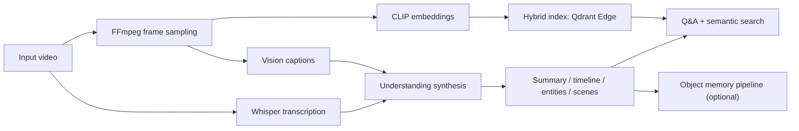
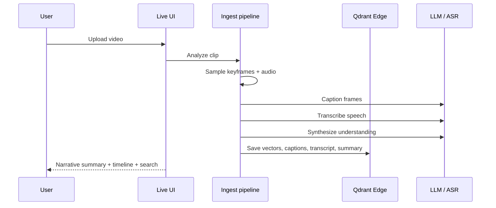

# VideoAI

<p align="center">
  
  
  
  
</p>

AI that understands videos.

A local-first video understanding pipeline that extracts key frames, transcribes speech, analyzes visual content, stores semantic memory, and answers questions about what happened in a clip.

> Project status: this repository is designed for local or self-hosted use. It is not currently tied to a public deployment endpoint or hosted demo.

## Why this project exists

VideoAI is built around a simple idea: instead of treating a video as a flat blob, it turns the video into a structured understanding layer.

- sample frames from the video
- encode frames and text into vectors
- caption each moment visually
- transcribe spoken audio
- synthesize a narrative summary, timeline, entities, and scenes
- allow follow-up questions and semantic frame retrieval using the structured context

The result is a system that can answer questions like:

- What happened in this video?
- Who or what appears most often?
- Where did the object last appear?
- What is the timeline of events?

## Architecture overview



## High-level pipeline



## Core capabilities

- Video summary generation from visual + speech context
- Timeline extraction and event understanding
- Semantic frame retrieval using CLIP + hybrid search
- Follow-up question answering over the video understanding state
- Optional object-level memory for tracking detected entities across a clip
- Local-first storage using Qdrant Edge
- FastAPI + WebSocket live UI for interactive analysis

## Repository layout

```text
.
├── app.py                  # local entrypoint for the live UI
├── Dockerfile              # Docker setup for containerized runs
├── requirements.txt        # Python dependencies
├── packages.txt            # OS packages
├── README.md               # project docs
├── eval/
│   ├── README.md           # benchmark instructions
│   └── nextqa.py           # NExT-QA evaluation harness
├── scripts/
│   └── set_space_secrets.py
├── videoqa/
│   ├── ask.py              # question answering
│   ├── caption.py           # per-frame captioning
│   ├── cli.py              # command line interface
│   ├── cleanup.py          # session cleanup logic
│   ├── detector.py         # detection-related utilities
│   ├── embed.py            # embedding logic
│   ├── frames.py           # frame extraction
│   ├── ingest.py           # ingestion pipeline
│   ├── live/               # live web UI and backend
│   ├── objects.py          # object memory support
│   ├── store.py            # hybrid vector store
│   ├── transcribe.py       # speech-to-text
│   └── understand.py       # video-level synthesis
├── .gitignore
└── .env.example (if added in your local setup)
```

## How the pipeline works

1. Frame extraction
   - FFmpeg samples keyframes at a configured interval.
   - This reduces the video to the most relevant moments before deeper analysis.

2. Embedding and indexing
   - Frames and captions are embedded with CLIP-style models.
   - The project uses local hybrid retrieval via Qdrant Edge to join semantic and lexical signals.

3. Visual understanding
   - Each sampled frame is captioned.
   - These captions become a dense event log for the video.

4. Audio understanding
   - Whisper transcribes the clip into timestamped speech.
   - Speech is merged with the visual log before video-level understanding is synthesized.

5. Structured synthesis
   - A language model reads the merged visual + spoken evidence.
   - It produces a summary, timeline, entities, scenes, and other structured outputs.

6. Answering and search
   - Follow-up questions use the understanding context plus retrieved frames.
   - This makes the system useful for narrative recall, event understanding, and object lookup.

## Local-first design

This project is intentionally local-first:

- no cloud database required
- no secret-heavy deployment model
- Qdrant Edge runs in-process
- sessions and data are ephemeral by default
- the project is designed to run on a laptop, workstation, or self-hosted environment

This makes it useful for experimentation, local AI workflows, and custom deployment setups without depending on an external public service.

## Setup

### Prerequisites

- Python 3.10+
- FFmpeg installed and available on PATH
- an OpenAI-compatible API key for the model backend used by the captioning / understanding pipeline

### Install

```bash
git clone https://github.com/Vatsa10/video-ai.git
cd video-ai
python -m venv .venv
source .venv/bin/activate
pip install -r requirements.txt
```

### Optional GPU setup

If you have CUDA available, use a matching PyTorch install for your GPU:

```bash
pip install torch --index-url https://download.pytorch.org/whl/cu128
```

## Environment configuration

Create a `.env` file in the project root:

```ini
OPENAI_API_KEY=sk-...
VIDEOQA_MODEL=gpt-4o-mini

# Optional overrides
# VIDEOQA_BASE_URL=https://api.moonshot.ai/v1
# VIDEOQA_ASR_MODEL=whisper-1
# VIDEOQA_CAPTION_WORKERS=16
# VIDEOQA_OBJECTS=1
# VIDEOQA_QUANT=scalar
# VIDEOQA_MMR=1
```

The project auto-loads environment variables from `.env`.

## Run the live UI

```bash
python -m videoqa.live
```

or:

```bash
python app.py
```

Then open:

```text
http://127.0.0.1:7860
```

From the UI you can upload a video and inspect:

- the live object memory
- the generated summary
- timeline events
- search results over stored frames and captions
- follow-up question capabilities

## CLI usage

Ingest a video:

```bash
python -m videoqa.cli ingest clip.mp4 --id myclip --interval 1.0
```

Ask a question about the clip:

```bash
python -m videoqa.cli ask myclip "what is the person holding?"
```

You can also attach more frames for richer answers:

```bash
python -m videoqa.cli ask myclip "summarize the action" -k 6
```

## Performance notes

- model warmup is handled at startup to reduce cold starts
- transcription and captioning are overlapped when possible
- captioning can be parallelized with `VIDEOQA_CAPTION_WORKERS`
- CPU works, but GPU is strongly recommended for live object detection and faster embeddings

## Evaluation

The repository includes a benchmark harness for NExT-QA. See the dedicated runbook:

- `eval/README.md`
- `eval/nextqa.py`

Example:

```bash
python -m eval.nextqa --selftest
```

## Deployment and hosting

This project is not currently deployed as a public, production-facing web app. It is meant to run as a local system or in a self-hosted environment.

If you want to deploy it somewhere, the codebase is structured around a Dockerized local service and a FastAPI app, but the repository does not assume a public hosted install is active by default.

## Roadmap

- motion-aware temporal modeling
- stronger temporal event reasoning
- better scene-level summarization
- more efficient long-video ingestion
- object memory improvements and tracking quality

## License

This project currently does not declare a repository license in the root metadata. If you plan to distribute or reuse it commercially, add a license file explicitly before publishing.

## Contributing

This is a research-oriented and experimentation-heavy project. Contributions are welcome in the areas of:

- model and retrieval quality
- performance and memory tuning
- UI improvements
- benchmarking and evaluation
- documentation and architecture clarity

---

Built for video understanding, local-first AI, and structured event memory.
